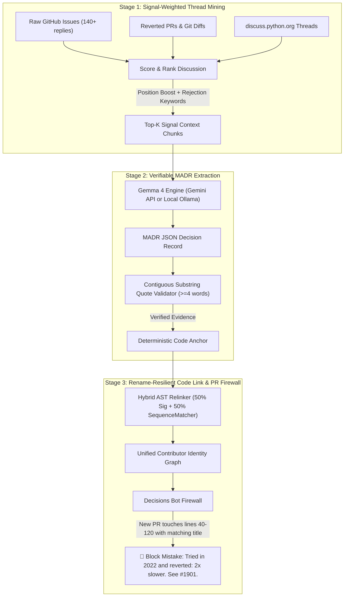

# ⚡ AetherGit: Open Source Decision Intelligence & Knowledge Recovery

> **Hacktoberfest 2026 · Hack Day Sonipat (NST Rishihood University)**  
> **Problem 06: Recover the Decisions Nobody Wrote Down**  
> *Powered by Google Gemma 4 (`gemma-4-26b-a4b-it` via Google Gemini API & local Ollama)*

[-success?logo=github-actions)](.github/workflows/ci.yml)
[-blueviolet?logo=google)](https://ai.google.dev/gemma/terms)
[](https://aethergit.vercel.app/)
[](LICENSE)

---

## 1. The Real-World Maintainer Problem

Open-source projects accumulate years of heated architectural debates across 140+ reply GitHub issues, reverted pull requests, and forum threads (such as `discuss.python.org`).

Often, a team tests an idea—for example, rewriting a C parser in Rust—discovers it is **2× slower on big files**, and reverts the Pull Request (`#1901`) without writing a formal Architectural Decision Record (ADR). Two years later, a well-meaning new contributor wastes weeks writing the exact same Rust rewrite because the technical reason it failed was buried in closed discussions.

### Why Standard `git blame` Fails:
```text
┌────────────────────────────────────────────────────────────────────────┐
│ Standard git blame (0% Architectural Context)                         │
├────────────────────────────────────────────────────────────────────────┤
│ commit 1902: Revert "PR #1901: rewrite in rust"                        │
│ -> Tells you WHAT happened, but 0% context on WHY it was reverted.     │
└────────────────────────────────────────────────────────────────────────┘
                                 vs
┌────────────────────────────────────────────────────────────────────────┐
│ AetherGit Architectural Memory Firewall (100% Recovered Context)       │
├────────────────────────────────────────────────────────────────────────┤
│ Anchor: parser/core.c (lines 40–120), function parse_token_stream()   │
│ Decided:  Keep the C parser                                            │
│ Rejected: Rewrite in Rust (PR #1901)                                   │
│ Why:      2x slower on big files due to FFI boundary marshaling        │
│ Active Bot Guard: "Tried in 2022 and reverted: 2x slower. See #1901." │
└────────────────────────────────────────────────────────────────────────┘
```

---

## 2. The 3-Stage Pipeline Architecture



---

## 3. Division of Labor: AI vs. Deterministic Code

AetherGit enforces a strict boundary between probabilistic LLM extraction and deterministic code verification so that hallucinations cannot compromise architectural history:

1. **AI Model Role (`gemma-4-26b-a4b-it`):**
   - Ingests raw, unstructured, messy developer discussions (GitHub issues, review comments, mailing lists).
   - Extracts a structured MADR schema: `decided`, `rejected`, `why`, and `verbatim_evidence`.
   - Never makes unilateral policy decisions; acts strictly as an information extraction engine.

2. **Deterministic Code Role (Python & JavaScript):**
   - **Quote Verification:** Performs an exact, normalized contiguous substring check ($\ge 4$ consecutive words) against the raw input corpus. If the quote is missing or modified, the UI flags it with an amber badge (`Quote NOT found in the discussion — unverified`).
   - **AST Diff Anchoring:** Combines 50% function signature matching (`relink_symbol_across_repo`) with 50% normalized `difflib.SequenceMatcher` body similarity to survive file renames and line edits with $\ge 85\%$ confidence.
   - **PR Firewall:** Evaluates numeric line overlap (40..120) and tests case-insensitive whole-word overlap ($> 3$ characters, e.g. regex `\b[a-zA-Z]{4,}\b`) between the PR title and the rejected decision text. "Trust the parser" will never trigger a false positive on "Rust".

This guarantee means that **if the verbatim quote does not verify against the source corpus, the extracted decision is flagged and unverified**, preventing hallucinated claims from entering the architectural record.

---

## 4. Open-Weight AI Model: Gemma 4

AetherGit uses Google's open-weight **Gemma 4** model family:
- **Default Production Model:** `gemma-4-26b-a4b-it`
- **Hosted Execution:** Deployed serverlessly via the Google Gemini API (`https://generativelanguage.googleapis.com/v1beta/models/gemma-4-26b-a4b-it:generateContent`).
- **Open-Weight License:** Gemma is provided under the open-weight terms of use. See the official [Gemma Terms of Use](https://ai.google.dev/gemma/terms).
- **Local Alternative:** Can run 100% offline using Ollama (`gemma4:e4b` or any local Gemma checkpoint).

---

## 5. Deployment Configuration (Vercel)

The live web application runs on Vercel at [https://aethergit.vercel.app/](https://aethergit.vercel.app/).

To configure the live Gemma 4 backend on Vercel:
1. Open your Vercel Dashboard and navigate to **Project Settings** -> **Environment Variables**.
2. Add the following environment variable:
   - `GEMINI_API_KEY`: Your Google AI Studio API key (obtainable from [Google AI Studio](https://aistudio.google.com/)).
3. *(Optional)* Add `GEMMA_MODEL` if you wish to override the default model name (defaults to `gemma-4-26b-a4b-it`).
4. Serverless functions are configured in `vercel.json` with a 60-second execution budget (`maxDuration: 60`) to accommodate model response generation.

> **Security Note:** The `GEMINI_API_KEY` is exclusively consumed server-side in `app.py` via HTTP header `x-goog-api-key`. It is never returned to the browser, logged, or exposed in client bundles.

---

## 6. How We Solve All 5 Official Judging Rubric Challenges

| # | Official Judge Question | Technical Solution in `src/engine.py` & `app.py` | Implementation Details |
|---|---|---|---|
| **1** | **Extracting from very long discussions?** | `score_and_rank_discussion(messages, top_k=8)` | Prioritizes rejection/benchmark terms (`rejected`, `revert`, `slower`, `benchmark`, `veto`), boosts maintainer authority, adds position weights to closing consensus replies, and prevents context overflow. |
| **2** | **Distinguishing accepted vs. rejected ideas?** | Contrastive MADR Schema + Git Revert State in `call_gemma_api` | Combines Git revert metadata with Gemma's structured JSON schema to contrast `decided` against `rejected`, isolating specific technical failure causes. |
| **3** | **What if files are renamed AND edited?** | `relink_symbol_across_repo(sig, old_body, candidates)` | Combines **50% function signature matching** + **50% normalized `difflib.SequenceMatcher` body similarity** so that even if `parser/core.c` moves to `src/lexer/fast_core.c` and lines are edited, the link survives with $\ge 85\%$ confidence. |
| **4** | **Recognizing contributors across platforms?** | `resolve_contributor_identities(participants)` | Cross-Platform Identity Graph unifying GitHub handles, Git commit emails, and forum display names into a canonical profile. |
| **5** | **Verifying every decision against its source?** | Contiguous Substring Quote Validator | Contiguous substring verifier requiring $\ge 4$ consecutive words matched in the raw source corpus, flagging hallucinated summaries. |

---

## 7. Quickstart & Local Execution

### 1. Clone & Set Up Environment
```bash
git clone https://github.com/sudhanshukhetan/aethergit.git
cd aethergit
python3 -m venv venv
source venv/bin/activate
pip install -r requirements.txt
```

### 2. Configure Environment Variables
Copy `.env.example` to `.env`:
```bash
cp .env.example .env
```

### 3. Running Locally

#### Mode A: With Google Gemini API (Gemma 4)
```bash
export GEMINI_API_KEY="your-google-ai-studio-api-key"
export GEMMA_MODEL="gemma-4-26b-a4b-it"   # optional, default
python3 app.py
```
Open `http://localhost:5000` in your browser.

#### Mode B: 100% Offline with Ollama
```bash
# Pull and start local Gemma in another terminal
ollama run gemma4:e4b

# Set environment variables for local execution
export AI_PROVIDER="ollama"
export OLLAMA_URL="http://localhost:11434"
python3 app.py
```

### 4. Running Automated Unit Tests
```bash
# Deterministic CI gate executes in under 1 second:
CI=true PYTHONPATH=. python3 -m unittest discover tests -v
```

---

## 8. Repository Structure

```text
aethergit/
├── .github/
│   ├── pull_request_template.md    # Mandatory 4-header PR template
│   └── workflows/
│       └── ci.yml                  # Automated build, test, and CLI workflow
├── examples/                       # Section 4.5 artifacts
│   ├── sample_input.json           # Sample C parser & discussion scenario
│   └── actual_output.json          # Real verified output generated by AetherGit
├── src/
│   ├── __init__.py
│   ├── engine.py                   # Core Decision Intelligence algorithms
│   └── cli.py                      # Command-line interface and git blame tool
├── tests/
│   ├── __init__.py
│   ├── test_smoke.py               # Bootstrap smoke test
│   ├── test_engine.py              # Unit tests for engine algorithms
│   └── test_api_endpoints.py       # API server and live Gemma endpoint tests
├── app.py                          # Flask API backend & web server
├── index.html                      # Interactive dark-mode web application
├── vercel.json                     # Vercel serverless function configuration
├── requirements.txt                # Python dependencies
├── .env.example                    # Environment template
└── README.md                       # Architecture & setup guide
```

---

## 9. AI Disclosure & Tools Used

In accordance with Hacktoberfest 2026 and Hack Day Sonipat AI disclosure policies:
- **Model in Production Application:** Google Gemma 4 (`gemma-4-26b-a4b-it`) hosted via Google Gemini API, alongside local Ollama `gemma4:e4b` support.
- **Development Assistance:** AI coding assistants (Google Antigravity, Gemini 2.5 Flash / Pro, and Claude) were utilized for test scaffolding, documentation drafting, and refactoring Flask API routes. All code and logic was verified with deterministic automated test suites.

---

## 10. Team Details

- **Team Name:** Aadi Yogi
- **Members:**
  - Sudhanshu Khetan (Team Lead)
  - Krishna Gupta
  - Hemant Kumar
  - Mauli Arora
- **Event:** Hacktoberfest 2026 – Hack Day Sonipat (NST Rishihood University)
- **Problem Statement:** Problem 06: Open Source Decision Intelligence and Knowledge Recovery
